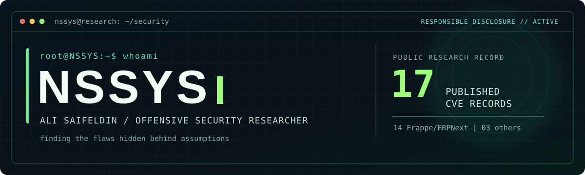

<!-- NSSYS · Offensive Security Research -->
<div align="center">

<a href="https://github.com/NSSYS">
  
</a>

<br/>

### `Security Researcher` · `Offensive Security` · `Exploit Development`

**Breaking assumptions. Finding root causes. Securing what matters.**

[](CVEs.md)
[](CVEs.md#frappe-framework-and-erpnext)
[](https://www.offsec.com/)
[](https://www.offsec.com/)
[](https://www.offsec.com/)

[](https://hackerone.com/nssys)
[](https://medium.com/@alisaifeldin)
[](https://www.linkedin.com/in/alisaifeldin/)

</div>

---

### `root@NSSYS:~# cat /etc/researcher.conf`

```ini
[identity]
name          = Ali Saifeldin
handle        = NSSYS
focus         = Vulnerability Research, Offensive Security
methodology   = Source Code -> Root Cause -> Exploitability -> Responsible Disclosure

[specialties]
application   = Web & API Security, Authentication, Authorization, IDOR
systems       = Windows Security, Local Privilege Escalation
infrastructure= Active Directory, Internal & External Penetration Testing
research      = Source-Code Auditing, Security Boundary Analysis, Exploit Development
defense       = Malware Analysis, Threat Hunting, Digital Forensics
```

I research vulnerabilities in real-world software, focusing on **broken trust boundaries**, **authorization flaws**, **privilege escalation**, and **sensitive-data exposure**. I combine manual code review and practical security testing with coordinated vulnerability disclosure.

### `./research --published`

<div align="center">

| **17** published CVEs | **14** Frappe / ERPNext CVEs | **3** other-project CVEs |
|:---:|:---:|:---:|
| [Complete CVE index](CVEs.md) | [Framework & ERP findings](CVEs.md#frappe-framework-and-erpnext) | [Node.js · Pyrus · pyLoad](CVEs.md#other-published-cves) |

</div>

**Selected disclosures**

| Research | Vulnerability class | Public reference |
|:---|:---|:---|
| **Pyrus Sync for Windows** | Local privilege escalation through a LocalSystem service | [CVE-2026-116596](https://www.cve.org/CVERecord?id=CVE-2026-116596) · [Write-up](https://medium.com/@alisaifeldin/cve-2026-116596-local-privilege-escalation-in-pyrus-sync-for-windows-0fe2417dc8cf) |
| **Node.js** | Proxy credential disclosure in tunnel error handling | [CVE-2026-48615](https://www.cve.org/CVERecord?id=CVE-2026-48615) |
| **Frappe Framework** | Broken authorization in email operations | [CVE-2026-50026](https://www.cve.org/CVERecord?id=CVE-2026-50026) |
| **ERPNext** | Unauthorized issue status modification | [CVE-2026-109669](https://www.cve.org/CVERecord?id=CVE-2026-109669) |
| **ERPNext** | Missing write authorization in payment reconciliation (`pause_job_for_doc`); disclosure ticket #66692 | [CVE-2026-72910](https://www.cve.org/CVERecord?id=CVE-2026-72910) · [GHSA](https://github.com/frappe/erpnext/security/advisories/GHSA-qpvh-75wh-j645) |
| **pyLoad** | Insufficient path restrictions | [CVE-2026-45306](https://www.cve.org/CVERecord?id=CVE-2026-45306) |

<div align="center">

### [`>> EXPLORE ALL 17 CVEs & SECURITY ADVISORIES <<`](CVEs.md)

</div>

### `./research --new-disclosure`

**[GHSA-89m3-vggh-725v](https://github.com/frappe/frappe/security/advisories/GHSA-89m3-vggh-725v)** — Frappe Framework security advisory. On **12 November 2026**, its maintainer invited **@NSSYS** to accept **Reporter** credit through GitHub. **CVE assignment and public advisory details are pending verification**, so it is listed separately from the 17 confirmed CVE identifiers.

**[GHSA-qpvh-75wh-j645 / CVE-2026-72910](https://github.com/frappe/erpnext/security/advisories/GHSA-qpvh-75wh-j645)** — On the same date, the ERPNext maintainer sent **@NSSYS** a Reporter credit invitation for an advisory covering `pause_job_for_doc` (reported in ticket **#66692**).

[**Disclosure and credit details →**](CVEs.md#frappe-advisory--reporter-credit-invited)

### `./toolkit --focus`

```text
RESEARCH    Code audit · Vulnerability analysis · AuthN/AuthZ · Privilege escalation
OFFENSIVE   Web & API pentesting · Active Directory · Red team · Exploit development
DEFENSIVE   Threat hunting · Malware analysis · SIEM/EDR · Incident response
```

**Professional certifications:** `OSCP` · `OSWE` · `OSEP`

### `./writeups --latest`

**[CVE-2026-116596 — Local Privilege Escalation in Pyrus Sync for Windows](https://medium.com/@alisaifeldin/cve-2026-116596-local-privilege-escalation-in-pyrus-sync-for-windows-0fe2417dc8cf)**

An investigation into a Windows service security boundary and a local privilege-escalation issue.

**[Read the disclosure archive →](CVEs.md)**

---

<div align="center">

`[ Research ]` **→** `[ Validate ]` **→** `[ Disclose ]` **→** `[ Improve Security ]`

<sub>Public CVE counts refer to published identifiers linked in the research index. Some advisories encompass multiple reports. Frappe has issued GitHub Reporter credit invitations for GHSA-qpvh-75wh-j645 and GHSA-89m3-vggh-725v; invitation acceptance and public attribution should be verified directly on GitHub.</sub>

</div>
